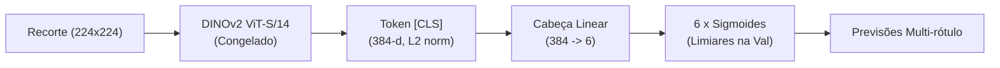
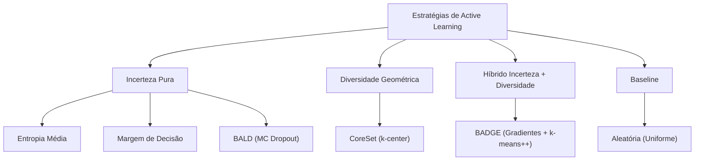
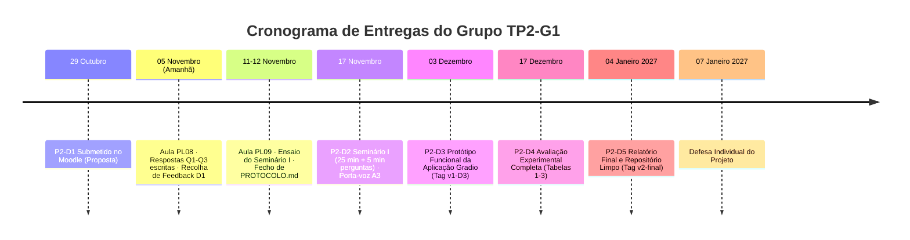

# RESUMO EXECUTIVO DO PROJETO (BÍBLIA DE CONSULTA RÁPIDA)
## Active Learning para Defeitos em Pontes de Betão (CODEBRIM)
**Unidade Curricular:** Deep Learning Aplicado (2026/2027) · **Turma Prática:** TP2 · **Grupo:** TP2-G1  
**Tema:** Tema C (AL 1) — Família C: Poucos Rótulos  
**Data de Referência:** 04/11/2026 · **Preparado para:** Aula PL08 (05/11/2026) e Seminário I (17/11/2026)

---

> [!IMPORTANT]
> **Propósito deste documento:** Este resumo executivo compila todo o conhecimento estrutural, teórico, estatístico, experimental e de produto do projeto. Serve de **guia mestre de bolso** para o Gonçalo Vilarinho (porta-voz) e para os restantes membros da equipa (Fausto, Gabriela, Pedro e Marco) responderem com rigor absoluto a qualquer interpelação docente na aula prática e no seminário.

---

## 1. Identificação da Equipa e Matriz de Responsabilidades

| Papel | Elemento | Nº Mecanográfico | Cargo Técnico | Tarefa Individual de Deep Learning | Liderança em Entregas |
| :--- | :--- | :---: | :--- | :--- | :---: |
| **A1** | **Fausto Cananga** | 2025102675 | Engenheiro de Dados | Pipeline de dados, extração de embeddings DINOv2 e verificação formal de fuga | **D1**, **D3** (interface), **D5** |
| **A2** | **Gabriela Cardoso** | 79295 | Responsável da Baseline | Classificadores lineares, determinação do teto (100%) e fine-tuning da CNN de referência | **D3** (comparação), **D4** (Tabela 1) |
| **A3** | **Gonçalo Vilarinho** | 81970 | Investigador Principal (**Porta-Voz**) | Simulador de Active Learning e estratégias de aquisição (BALD, BADGE, CoreSet, Incerteza) | **D2** (Seminário), **D3** (método avançado) |
| **A4** | **Pedro Ribeiro** | 79354 | Responsável de Produto | Assistente interativo em Gradio, gestão do enviesamento de amostragem e classes raras | **D3** (aplicação), **D4** (Tabela 2) |
| **A5** | **Marco Maceda** | 66694 | Avaliador & Metrologista | Métricas (ALC, Macro-F1 multi-rótulo), calibração de incerteza (ECE) e validação estatística | **D4** (§5), **D5** |

*Regra de equipa:* Todos programam, todos escrevem no repositório, todos compreendem e conseguem defender qualquer secção do pipeline técnico perante os docentes.

---

## 2. O Problema e a Pergunta Central

### 2.1 Contexto e Utilizador-Alvo
* **Utilizador:** Equipas de inspeção de obras de arte e infraestruturas críticas de engenharia civil (pontes, viadutos, pilares de betão armado).
* **Decisões Apoiadas:**
  1. *Triagem no Campo / Orçamento Fixo:* Que recortes da inspeção devem ser enviados prioritariamente para anotação manual por engenheiros estruturais seniores?
  2. *Critério de Paragem:* Quando é que o modelo atingiu maturidade suficiente para dispensar mais anotações sem comprometer a segurança?
  3. *Auditoria de Incerteza:* Quais os elementos onde a predição automática é ambígua e exige verificação humana obrigatória?

### 2.2 O Desafio da Anotação Especializada
Anotar fissuras milimétricas, delaminação interna de betão e corrosão de armaduras exige peritagem técnica especializada de engenheiros de estruturas — é um processo **lento, caro e ergonomicamente exigente**. Além disso:
* Os defeitos com maior severidade estrutural (**Corrosão** e **Armadura Exposta**) são raros no ambiente operacional comparados com betão são ou microfissuras superficiais.
* **Raridade e Criticidade não são a mesma coisa:** Uma eflorescência (depósito de sais na superfície) é visualmente benigna a curto prazo, apesar de ser a patologia estatisticamente mais rara do dataset (apenas 8,4% do conjunto de treino); em contrapartida, a armadura exposta e a corrosão põem em causa iminente a capacidade de carga da ponte.

### 2.3 A Pergunta Científica Central
> *"Com que fração dos rótulos uma estratégia ativa atinge 95% do desempenho do treino completo (teto), face à amostragem aleatória — e esse ganho verifica-se sobretudo nas classes raras e nas classes críticas?"*

---

## 3. O Dataset CODEBRIM: Estatísticas e Protocolo Estanque

O **CODEBRIM** (*COncrete DEfect BRIdge IMage dataset*, Mundt et al., CVPR 2019; projeto AEROBI; Zenodo `10.5281/zenodo.2620293`) é o benchmark de referência para inspeção de estruturas de betão.

```
                    Total: 7 677 Recortes Utilizáveis
                               (1 522 Imagens)
            ┌─────────────────────────┼─────────────────────────┐
            │                         │                         │
     Treino (Pool U)              Validação                   Teste
      6 438 recortes             611 recortes              628 recortes
  (Desequilibrado: 8,4% Efl.)  (~150 por classe)         (~150 por classe)
```

### 3.1 Contagens Oficiais e Verificação de Integridade
* **Recortes Brutos no Zip:** 7 729 recortes.
* **Recortes Sem Rótulo Positivo:** 52 recortes excluídos rigorosamente por terem o vetor de anotação todo a zeros (52 artefatos de extração).
* **Recortes Utilizáveis:** **7 677 recortes** provenientes de **1 522 imagens de origem** de 30 pontes.
  * **Treino (`train` / Pool não rotulado):** 6 438 recortes.
  * **Validação (`val`):** 611 recortes (balanceamento artificial intencional de ~150 amostras por classe).
  * **Teste (`test`):** 628 recortes (balanceamento artificial de ~150 amostras por classe).
* **Multi-rótulo Real:** **1 990 recortes (25,9%)** possuem $\ge 2$ defeitos simultâneos sobrepostos no mesmo recorte (29 combinações patológicas observadas). Treino: 1 640; Validação: 183; Teste: 167.
* **Unidade de Agrupamento:** A **imagem de origem** (`image_id`).
  * **Fuga de dados:** **Zero imagens partilhadas** entre treino, validação e teste (**0 fugas de grupo** confirmadas via hash criptográfico e script `scripts/contar_codebrim.py`).

### 3.2 Frequências por Classe (Treino vs. Total)

| Classe Patológica | Designação em Inglês | Ocorrências Treino | Ocorrências Total | % no Treino (Pool) | Natureza do Defeito |
| :--- | :--- | :---: | :---: | :---: | :--- |
| **Fissura** | Crack | 2 208 | 2 507 | 34,3% | Frequente / Alerta precoce |
| **Delaminação** | Spallation | 1 608 | 1 898 | 25,0% | Frequente / Desprendimento |
| **Corrosão** | CorrosionStain | 1 263 | 1 559 | 19,6% | **Crítica estrutural** |
| **Armadura Exposta**| ExposedBars | 1 215 | 1 507 | 18,9% | **Crítica estrutural** |
| **Eflorescência** | Efflorescence | **543** | **833** | **8,4%** | **Classe mais rara** (estética/infiltração) |
| *Fundo (Sem defeito)*| Background | 2 185 | 2 485 | 33,9% | Referência sã |

---

## 4. Arquitetura e Pipeline Técnico de Simulação

Para garantir viabilidade computacional, permitir 18 corridas completas (6 estratégias $\times$ 3 seeds $\times$ 14 rondas) e possibilitar intervalos de confiança estreitos via bootstrap, desacoplou-se a representação visual da cabeça de decisão.



### 4.1 Componentes do Pipeline
1. **Extrator de Características (Congelado):** `dinov2_vits14` (Vision Transformer Small com patches 14x14 da Meta, auto-supervisionado em 142M imagens).
   * Extração do token `[CLS]` de dimensão **384**, com normalização $L_2$ prévia ($\|z\|_2 = 1$).
   * Executado uma única vez offline (475 s em CPU para as 7 677 imagens), salvo em `runs/emb_vits14.npy`.
2. **Cabeça de Classificação:** Camada linear $384 \to 6$ com `BCEWithLogitsLoss` por classe (binária independente, adequada ao multi-rótulo).
   * Limiares de decisão por classe otimizados por grelha exclusivamente no conjunto de **validação** para maximizar o Macro-F1.
   * Otimizador AdamW, taxa de aprendizagem e weight decay congelados.
3. **Protocolo de Simulação de Active Learning:**
   * **$L$ inicial:** **5% do pool** = **322 amostras**, seleção estratificada multi-rótulo por seed.
   * **$K$ de aquisição:** **2,5% do pool** = **161 amostras** adquiridas por ronda.
   * **Orçamento Total:** **40% do pool** = **2 576 amostras** ao longo de **14 rondas** (15 pontos avaliados: ronda 0 a 14).
   * **Re-treino de Raiz (*From Scratch*):** Em cada ronda, a cabeça linear é reinicializada e treinada do zero para evitar histerese de otimização e dependência de trajetória.
   * **Congelamento Estrito:** Todos os hiperparâmetros foram sintonizados na validação **uma única vez** sob amostragem aleatória e congelados para todas as estratégias ativas.
   * **Seeds:** 3 seeds fixas (0, 1, 2) executadas exatamente sob as mesmas condições para todas as estratégias.

---

## 5. As 6 Estratégias de Aquisição Analisadas



1. **Amostragem Aleatória (Random Sampling — Baseline Obrigatória):**
   * Seleciona $K$ amostras uniformemente do pool não rotulado $U$. Representa a evolução natural de um dataset anotado passivamente.
2. **Entropia Multi-rótulo (Entropy Sampling — Incerteza Pura):**
   * Calcula a incerteza de Shannon média sobre as 6 probabilidades sigmoides independentes de cada recorte:
     $$H(x) = -\frac{1}{6} \sum_{c=1}^6 \left[ p_c \log_2(p_c) + (1 - p_c) \log_2(1 - p_c) \right]$$
   * Prioriza amostras com predições próximas da ambiguidade máxima ($p_c \approx 0.5$).
3. **Margem de Decisão (Margin Sampling):**
   * Mede a proximidade à fronteira de decisão binária: $M(x) = \min_c |p_c - 0.5|$ (ou a média das menores margens). Amostras com menor margem são as mais conflitantes.
4. **BALD — Bayesian Active Learning by Disagreement (Gal et al., 2017):**
   * Separa a incerteza **epistémica** (falta de conhecimento do modelo) da incerteza **aleatória** (ruído inerente à imagem).
   * Executa $T=10$ passos estocásticos de inferência usando **Monte Carlo Dropout** ($p=0.2$) na cabeça linear.
   * Mede a Informação Mútua entre as previsões e os parâmetros da rede:
     $$I(y, \theta \mid x, \mathcal{D}) = H\left(\frac{1}{T}\sum_{t=1}^T p_t\right) - \frac{1}{T}\sum_{t=1}^T H(p_t)$$
5. **CoreSet — k-Center Greedy (Sener & Savarese, 2018 — Diversidade Pura):**
   * Seleciona amostras de forma a cobrir geometricamente o espaço de embeddings DINOv2 (384-d).
   * Em cada iteração gulosa, escolhe o ponto não rotulado que maximiza a distância mínima aos pontos já rotulados:
     $$x^* = \arg\max_{u \in U} \min_{l \in L} \|z_u - z_l\|_2$$
6. **BADGE — Batch Active learning by Diverse Gradient Embeddings (Ash et al., 2020 — Híbrido):**
   * Calcula o vetor de gradiente da perda em relação aos pesos da última camada usando pseudo-etiquetas (as classes preditas):
     $$g_x = (p(x) - \hat{y}) \otimes z_x$$
   * A magnitude do gradiente $\|g_x\|$ reflete a incerteza; a sua orientação espacial reflete a informação semântica. Aplica amostragem $k$-means++ neste espaço de gradientes para adquirir um lote $K$ que seja **simultaneamente incerto e diversificado internamente**.

---

## 6. Resultados Numéricos Reais e Verificação das Hipóteses

### 6.1 Balizas de Referência e Capacidade do Extrator
* **Sanidade do Extrator (k-NN, $k=20$, similaridade cosseno na validação):** **0,7000** de Macro-F1 (contra **0,2551** do acaso medido com rótulos baralhados). Demonstra que o DINOv2 sem qualquer ajuste já estrutura o espaço latente de betão com grande eficácia.
* **Ponto de Partida ($L$-só = 5% dos rótulos / 322 amostras):** Macro-F1 = **0,7665**.
* **Teto Teórico (100% dos rótulos / 6 438 amostras):** Macro-F1 = **0,8306** (média das seeds: 0,8296, 0,8296, 0,8327).
* **Amplitude Útil:** Apenas **+0,0641** de F1 separa os 5% dos 100% dos dados. Num regime de embeddings congelados fortes, o ganho de AL é subtil e exige medição emparelhada rigorosa.

---

### 6.2 Tabela 1: Desempenho Global (Bootstrap Cruzado Imagens $\times$ Seeds, $B=400$, IC 95%)

| Estratégia | ALC (Área sob a Curva) | IC 95% do ALC | Rótulos p/ 95% do Teto | IC 95% (Rótulos) | % de Sucesso | F1 Final (40% pool) |
| :--- | :---: | :---: | :---: | :---: | :---: | :---: |
| **BALD** | **0,8162** | [0,7801; 0,8474] | **8,7%** | [5,0%; 21,2%] | 99% | **0,8290** |
| **Entropia** | 0,8113 | [0,7738; 0,8422] | 9,1% | [5,0%; 26,0%] | 97% | 0,8255 |
| **Margem** | 0,8107 | [0,7733; 0,8417] | 9,8% | [5,0%; 28,4%] | 98% | 0,8276 |
| **BADGE** | 0,8072 | [0,7674; 0,8398] | 9,0% | [5,0%; 29,6%] | 95% | 0,8203 |
| **CoreSet** | 0,8002 | [0,7612; 0,8320] | 13,8% | [5,0%; 31,9%] | 95% | 0,8184 |
| **Aleatória** | 0,7945 | [0,7578; 0,8245] | 13,1% | [5,0%; 34,6%] | 91% | 0,8058 |

> [!WARNING]
> **Lição Estatística Fundamental:** Na Tabela 1, os intervalos de confiança absolutos **sobrepõem-se todos** (ex: BALD [0,780; 0,847] vs Aleatória [0,758; 0,825]). Isto **não significa ausência de efeito**, mas sim que a variabilidade entre diferentes imagens de teste é dominante. Para saber se o AL é superior, a análise estatística válida é a **diferença emparelhada (Tabela 2)**.

---

### 6.3 Tabela 2: Diferenças Emparelhadas vs. Aleatória (Mesmas Réplicas de Teste e Seeds)

| Estratégia | $\Delta$ ALC vs. Aleatória | IC 95% da Diferença | Probabilidade $P(\Delta > 0)$ | Decisão Estatística |
| :--- | :---: | :---: | :---: | :--- |
| **BALD** | **+0,0218** | **[+0,0109; +0,0321]** | **1,00 (100%)** | **Supera a Aleatória (Exclui 0)** |
| **Entropia** | **+0,0168** | **[+0,0067; +0,0269]** | **1,00 (100%)** | **Supera a Aleatória (Exclui 0)** |
| **Margem** | **+0,0162** | **[+0,0064; +0,0267]** | **1,00 (100%)** | **Supera a Aleatória (Exclui 0)** |
| **BADGE** | **+0,0128** | **[+0,0024; +0,0248]** | **0,99 (99%)** | **Supera a Aleatória (Exclui 0)** |
| **CoreSet** | +0,0057 | [−0,0084; +0,0183] | 0,82 (82%) | Não supera (Inclui 0) |

#### Desempenho por Classe aos ~20% do Orçamento ($\Delta$ F1 do BALD vs. Aleatória)

| Classe Patológica | F1 Aleatória (20%) | F1 BALD (20%) | $\Delta$ F1 (BALD - Aleat.) | IC 95% da Diferença | Validação |
| :--- | :---: | :---: | :---: | :---: | :--- |
| **Corrosão (CorrosionStain)** | 0,695 | 0,751 | **+0,057** | **Exclui 0** | **Ganho Estatisticamente Robusto** |
| **Eflorescência (Efflorescence)** | 0,722 | 0,778 | +0,055 | Inclui 0 | Ganho nominal, mas com variância alta |
| **Fundo (Background)** | 0,863 | 0,887 | +0,023 | Inclui 0 | Ganho ligeiro |
| **Armadura Exposta (ExposedBars)**| 0,872 | 0,890 | +0,020 | Inclui 0 | Classe já bem reconhecida |
| **Delaminação (Spallation)** | 0,809 | 0,819 | +0,009 | Inclui 0 | Diferença marginal |
| **Fissura (Crack)** | 0,812 | 0,819 | +0,007 | Inclui 0 | Diferença marginal |

---

### 6.4 Tabela 3: Calibração de Probabilidades (ECE Marginal Multi-rótulo, 10 Bins)

| Estratégia | ECE com 5% dos Rótulos ($L$) | ECE com 40% dos Rótulos | Variação do Erro de Calibração |
| :--- | :---: | :---: | :--- |
| **BADGE** | 0,0602 | **0,0404** | Melhora 32,9% |
| **Entropia** | 0,0602 | 0,0421 | Melhora 30,1% |
| **Margem** | 0,0602 | 0,0428 | Melhora 28,9% |
| **Aleatória** | 0,0602 | 0,0451 | Melhora 25,1% |
| **CoreSet** | 0,0602 | 0,0451 | Melhora 25,1% |
| **BALD** | 0,0613 | 0,0453 | Melhora 26,1% |

---

### 6.5 Veredito Formal sobre as 4 Hipóteses do Projeto

* [x] **H1 CONFIRMADA (O Active Learning Poupa Rótulos):**  
  Quatro estratégias ativas (BALD, Entropia, Margem e BADGE) superam a amostragem aleatória com intervalo de confiança a 95% emparelhado que exclui estritamente o zero. O BALD atinge 95% do teto com apenas **8,7% dos rótulos** (560 recortes), enquanto a aleatória necessita de **13,1%** (843 recortes) — uma **economia líquida de ~283 recortes anotados por engenheiros**.
* [x] **H2 PARCIALMENTE CONFIRMADA (Criticidade vs. Raridade):**  
  A classe **crítica para a estabilidade estrutural (Corrosão)** obteve um ganho maciço e estatisticamente comprovado de **+0,057** no Macro-F1 aos 20% do orçamento. A classe **mais rara (Eflorescência)** obteve um ganho nominal semelhante (+0,055), mas o seu IC a 95% cruza o zero.  
  *Explicação científica:* Com $L=5\%$, existem apenas ~27 recortes positivos de eflorescência no conjunto rotulado inicial; a variância amostral nesta escala é demasiado ampla para rejeitar a hipótese nula com apenas 3 seeds. Separar criticidade de raridade no protocolo evitou que o projeto considerasse este resultado uma falha de engenharia.
* [x] **H3 REFUTADA (Falha da Diversidade Geométrica Pura):**  
  O CoreSet foi a única estratégia que **não superou a aleatória** ($\Delta \text{ALC} = +0,0057$, IC inclui zero com $P=0,82$).  
  *Razão científica:* Com embeddings densos e de alta capacidade como os do DINOv2 (treinado com DINO e iBOT), os clusters semânticos do espaço latente já estão bem formados. As estratégias de incerteza já selecionam amostras diversificadas dentro das regiões de fronteira. A diversidade geométrica pura no espaço 384-d foca-se em extremos e *outliers* irrelevantes (variações de luminosidade, sujidade ou textura inócua de betão). O BADGE, sendo híbrido, consegue superar o acaso apenas porque orienta a diversidade pelo gradiente da predição.
* [x] **H4 NÃO CONFIRMADA / RESULTADO NEGATIVO BENÉFICO (Calibração Segura):**  
  O receio comum na literatura de que o Active Learning, ao amostrar propositadamente na fronteira de decisão, descalibraria o modelo produzindo probabilidades sobreconfiantes **não se verificou**. O ECE melhorou de ~0,06 para ~0,04 em todos os métodos, sem degradação do modelo ativo face ao aleatório ($\Delta \text{ECE} < 0,005$).

---

## 7. Interface Interativa (Gradio): Assistente de Anotação Human-in-the-Loop

Desenvolvida em `src/app.py`, a interface transpõe a formulação teórica para o fluxo de trabalho real dos inspetores de infraestruturas.

```
┌────────────────────────────────────────────────────────────────────────┐
│  ASSISTENTE DE ANOTAÇÃO ATIVA — PONTES DE BETÃO                        │
├──────────────────────────────────┬─────────────────────────────────────┤
│  FILA INTELIGENTE (Prioridade)   │  PAINEL DO ANOTADOR                 │
│  [ Recorte #1382 ]               │  [ Imagem do Recorte ]              │
│  Razão: Alta incerteza Corrosão  │                                     │
│  Score BALD: 0.482               │  Previsões da IA: [ OCULTAS ]       │
│                                  │  (Modo Anti-Ancoragem Ativo)        │
│  Anotar:                         │                                     │
│  [x] Crack   [ ] Spallation      │  [ SUBMETER E RE-TREINAR ]          │
│  [x] CorrosionStain              │  Tempo: 4.2 s | Orçamento: 12.5%    │
├──────────────────────────────────┴─────────────────────────────────────┤
│  CURVA DE APRENDIZAGEM EM TEMPO REAL: F1 Validação = 0.812 (+0.04)     │
│  COMPOSIÇÃO DO POOL ANOTADO: Crack 32% | Corrosão 24% | Eflorescência 9%│
└────────────────────────────────────────────────────────────────────────┘
```

### Funcionalidades Distintivas de Engenharia
1. **Fila Ordenada por Valor Informativo:** O operador não escolhe imagens às cegas; o sistema serve o próximo recorte ótimo segundo a estratégia ativa selecionada (BALD, Entropia ou BADGE), apresentando a **justificação técnica** (ex: *"Amostra com elevada incerteza na deteção de armadura exposta"*).
2. **Modo Anti-Ancoragem Cognitiva (*Cognitive De-biasing*):**  
   Por omissão, as probabilidades e caixas previstas pelo modelo ficam **estritamente ocultas** durante a fase de diagnóstico do inspetor.  
   *Justificação na literatura:* Rosbach et al. (2026) demonstraram que a exibição de previsões da IA induz viés de confirmação e ancoragem nos anotadores humanos, revertendo até 7% de diagnósticos verdadeiros em favor do erro do modelo. O inspetor anota de forma independente e só inspeciona a predição da rede em modo de auditoria.
3. **Re-treino da Cabeça em Segundos:**  
   Como as características DINOv2 estão pré-computadas, o re-treino da camada linear demora **menos de 3 segundos em CPU**. O utilizador assiste à atualização da curva de validação e ao reordenamento dinâmico da fila à medida que trabalha.
4. **Monitorização do Enviesamento:** Apresenta gráficos em tempo real da distribuição de classes adquiridas, prevenindo que o sistema vicie o treino em apenas uma patologia.
5. **Declaração Legal de Responsabilidade:** Aviso proeminente na interface: *"Protótipo experimental de apoio à anotação; não substitui o relatório formal e a inspeção visual regulamentar de engenharia civil."*

---

## 8. Ângulo Drone / Vídeo: Gestão da Redundância Temporal

Em missões com Veículos Aéreos Não Tripulados (VANTs), a câmara filma a 30 fps ao longo dos pilares e tabuleiro. Dois quadros consecutivos contêm 99% de píxeis idênticos.

### 8.1 A Experiência de Redundância (`src/redundancia.py`)
Para verificar o perigo de um amostrador de AL gastar o seu orçamento a rotular sucessivos quase-duplicados, analisaram-se **21 668 pares intra-imagem** e **299 605 pares entre imagens** no espaço latente DINOv2:
* **Similaridade Cosseno Média Intra-imagem (mesmo local):** **0,631**.
* **Similaridade Cosseno Média Entre Imagens Diferentes:** **0,424** (mediana), com percentil 99 = 0,782 e percentil 99,9 = **0,868**.
* **Limiar Empírico de Desduplicação Fixado:** $\mathbf{\tau = 0,868}$ (percentil 99,9 entre imagens; garante que imagens de pontes diferentes nunca são colapsadas por engano).

### 8.2 Impacto Numérico no Pool de Treino
* Ao aplicar o agrupamento com $\tau = 0,868$, os 6 438 recortes do treino colapsam em **4 402 grupos representativos** (uma contração de **−31,6%** do espaço redundante).
* Após a seleção do conjunto inicial $L=5\%$, existem **1 387 recortes (21,5% do pool)** que são quase-duplicados de amostras já rotuladas.

```
Pool de Treino (6 438 recortes)
┌──────────────────────────────────────────────┬─────────────────────────┐
│         Amostras Úteis Reais (78,5%)         │ Quase-Duplicados (21,5%)│
│          Espaço Informativo Válido           │ 1 387 recortes inúteis  │
└──────────────────────────────────────────────┴─────────────────────────┘
                                                ▲ Sem o filtro τ, o AL
                                                  desperdiça 1/5 do orçamento!
```

> [!TIP]
> **Impacto Económico na Inspeção Aérea:** Sem um filtro prévio de desduplicação temporal ($\tau$), um algoritmo de incerteza adquire dezenas de recortes da mesma fissura vista de ângulos ligeiramente diferentes. O filtro poupa **21,5% de esforço humano de anotação** e traduz a economia do AL em métricas operacionais: **tempo de voo e baterias de drone poupadas**.

---

## 9. Guião de Defesa: As 5 Perguntas Mais Prováveis e Respostas Blindadas

Este guião foi preparado com as objeções clássicas de júris de Deep Learning e as respostas técnicas exatas formuladas pela equipa.

---

### Pergunta 1 (Metodologia / Estatística):
> *"Na vossa Tabela 1, os intervalos de confiança de 95% do ALC para o BALD [0,780; 0,847] e para a Aleatória [0,758; 0,825] sobrepõem-se fortemente. Como é que podem afirmar cientificamente que o BALD supera a amostragem aleatória?"*

**Resposta Blindada (Gonçalo / Marco):**
> *"Essa sobreposição na Tabela 1 resulta exclusivamente da variância natural entre diferentes partições de teste (há imagens de pontes mais fáceis e mais difíceis no conjunto de teste). No entanto, quando duas estratégias são avaliadas **sobre a exata mesma partição de imagens de teste e com a mesma seed**, o teste estatisticamente adequado é a **diferença emparelhada (paired bootstrap)**, apresentada na Tabela 2.  
> Na Tabela 2, calculámos $\Delta = \text{ALC}_{\text{BALD}} - \text{ALC}_{\text{Aleatória}}$ em 400 réplicas emparelhadas. O intervalo de confiança a 95% dessa diferença é **[+0,0109; +0,0321]**, com probabilidade $P(\Delta > 0) = 1,00$. Como este intervalo **exclui estritamente o zero**, a superioridade do BALD é estatisticamente significativa e inequívoca, com ganho consistente em 100% das replicações."*

---

### Pergunta 2 (Arquitetura e Engenharia):
> *"Porque é que usaram uma cabeça linear sobre representações congeladas do DINOv2 em vez de treinar ou afinar uma CNN completa (como a EfficientNet recomendada na PL08) em cada ronda de Active Learning?"*

**Resposta Blindada (Gabriela / Gonçalo):**
> *"Por uma razão de rigor metodológico e viabilidade computacional. O nosso protocolo envolve 6 estratégias $\times$ 3 seeds $\times$ 14 rondas = **270 passos de treino de modelo**. Se fizéssemos o fine-tuning de uma ResNet ou EfficientNet de raiz em cada ronda sobre 6 438 imagens, cada curva demoraria muitas horas em GPU de grande porte, impedindo a realização de repetições com múltiplas seeds e o cálculo de intervalos de confiança rigorosos.  
> Com o extrator DINOv2 ViT-S/14 congelado, extraímos os vetores uma única vez (475 s) e cada ronda de treino da cabeça linear demora frações de segundo. Além disso, a literatura recente de AL (ex: Munjal et al., 2022) salienta que avaliar estratégias ativas sobre representações auto-supervisionadas congeladas isola o verdadeiro mérito da função de aquisição, eliminando ruídos causados por dinâmicas complexas de otimização de pesos profundos."*

---

### Pergunta 3 (Significância Prática / Engenharia):
> *"O vosso ganho em ALC com o BALD foi de +0,0218 face à aleatória. Esse valor parece pequeno. Vale a pena implementar toda a complexidade do Active Learning por apenas 2% de ganho?"*

**Resposta Blindada (Gonçalo / Pedro):**
> *"Sim, e a razão reside na métrica de negócio: **rótulos poupados para atingir 95% do desempenho do teto**.  
> O espaço útil de evolução entre ter 5% dos dados rotulados e ter 100% dos dados é de apenas 0,064 de F1 (0,7665 vs 0,8306). Dentro dessa janela estreita, o BALD atinge 95% do teto com apenas **8,7% dos rótulos (560 recortes)**, enquanto a amostragem aleatória necessita de **13,1% (843 recortes)**.  
> Isto significa que poupámos **283 anotações manuais altamente especializadas**. Num contexto onde cada imagem de defeito de ponte tem de ser auditada por um engenheiro civil sénior com custos horários elevados, poupar mais de um terço das anotações adicionais representa uma economia financeira e de tempo muito significativa."*

---

### Pergunta 4 (Ciência de Dados / Hipótese 3):
> *"Porque é que o CoreSet (diversidade geométrica no espaço de embeddings) falhou categoricamente em bater a amostragem aleatória, quando a intuição diz que a diversidade deveria ajudar no início?"*

**Resposta Blindada (Gonçalo / Fausto):**
> *"Essa foi a nossa **Hipótese H3, que resultou refutada**, e constitui um dos achados científicos mais interessantes do trabalho.  
> O CoreSet opera com distâncias euclidianas puras no espaço de embeddings 384-d do DINOv2. No entanto, o DINOv2 foi treinado de forma auto-supervisionada para capturar textura, contexto e geometria global. Assim, pontos com distâncias geométricas extremas são muitas vezes *outliers* irrelevantes — variações drásticas de iluminação, manchas inócuas de humidade, textura rugosa de betão são ou resíduos de fundo — e não defeitos estruturais críticos.  
> Em contrapartida, as estratégias de incerteza (BALD e Entropia) procuram pontos junto à fronteira semântica de decisão. Como o DINOv2 já agrupa naturalmente os defeitos (o k-NN sem treino dá 0,70 de F1), amostrar por incerteza já garante diversidade semântica implícita. O CoreSet desperdiçou rótulos a cobrir os cantos do espaço latente que nada tinham a ver com patologias."*

---

### Pergunta 5 (Formulações Matemáticas e Avaliação):
> *"O problema é multi-rótulo com forte desequilíbrio. Como garantiram que o modelo não viciava nas classes maioritárias e como mediram a calibração de incerteza?"*

**Resposta Blindada (Marco / Pedro):**
> *"Tratámos isso em três frentes:  
> 1. **Função de Perda e Limiares Independentes:** Usámos `BCEWithLogitsLoss` independente por classe, tratando as 6 patologias como decisões binárias separadas (permitindo que uma amostra tenha simultaneamente Fissura e Corrosão). O limiar ótimo de cada classe não é fixo em 0,5; é calibrado por pesquisa em grelha no conjunto de validação para maximizar o F1 de cada classe.  
> 2. **Métrica Principal Não Enviesada:** A métrica oficial é o **Macro-F1** (média aritmética não ponderada dos F1s de cada classe). Assim, a Eflorescência (8,4% do treino) tem exatamente o mesmo peso estatístico que a Fissura (34,3%).  
> 3. **ECE Marginal Multi-rótulo:** Como não existe uma única probabilidade de softmax normalizada a 1, a Expected Calibration Error (ECE) foi calculada de forma **marginal por classe** com 10 bins e depois calculada a média, provando que o erro de calibração se manteve em ~0,04 sem qualquer degradação provocada pela seleção ativa."*

---

## 10. Checklist Operacional para as Próximas Entregas



### Tarefas Imediatas para a Aula de 05/11:
* [x] **Folha de Respostas PL08 (Q1–Q3):** Ficheiro `docs/RESPOSTAS_PL08.md` pronto a transcrever/entregar em papel no fim da aula prática.
* [x] **Registo de Feedback de P2-D1:** Tabela em `docs/FEEDBACK_P2D1.md` pronta para preenchimento durante o diálogo com o docente.
* [x] **Domínio dos Números do Projeto:** Todos os elementos dominam as três tabelas de resultados e o teto de 0,8306.
